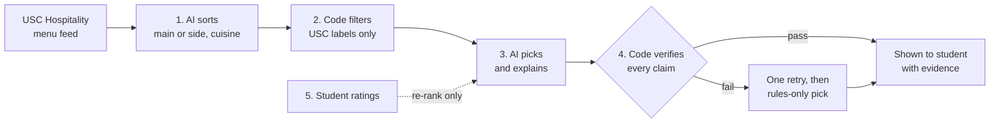

# ForkCast

[](https://github.com/viktor-lorentz/ForkCast/actions/workflows/ci.yml)

**Know before you go.** ForkCast tells each USC student which dining hall has food they can actually eat, every meal. AI picks the plate; code enforces USC's allergen labels.

By team **Overcooked** · AI@USC Hackathon, Nov 14–15, 2026

## Start here

| | Link |
| --- | --- |
| **Live app** | https://forkcast-usc.vercel.app |
| **Demo video** | https://youtu.be/WduILRF1jaY |
| **Slide deck** | https://forkcast-usc.vercel.app/forkcast-deck.html ([file in this repo](docs/deck/forkcast-deck.html)) |
| **Devpost text** | [docs/devpost.md](docs/devpost.md) |
| **How it works** | [docs/ARCHITECTURE.md](docs/ARCHITECTURE.md) |
| **Proof it works** | [docs/VERIFICATION.md](docs/VERIFICATION.md) |
| **Security** | [SECURITY.md](SECURITY.md) |
| **Survey data** | [docs/survey](docs/survey) (50 USC students, names removed) |
| **All docs** | [docs/README.md](docs/README.md) |

**Try a sample student, no setup:** [halal + sesame allergy](https://forkcast-usc.vercel.app/?demo=halal-sesame) · [vegan + gluten-free](https://forkcast-usc.vercel.app/?demo=vegan-gluten-free) · [nut allergy](https://forkcast-usc.vercel.app/?demo=nut-allergy) · [celiac](https://forkcast-usc.vercel.app/?demo=celiac) · [vegetarian + dairy-free](https://forkcast-usc.vercel.app/?demo=vegetarian-dairy-free) · [seafood allergy](https://forkcast-usc.vercel.app/?demo=seafood-allergy) · [egg + soy](https://forkcast-usc.vercel.app/?demo=egg-soy) · [no restrictions](https://forkcast-usc.vercel.app/?demo=no-restrictions)

## The problem

USC's dining site shows one hall at a time, and every dish is followed by a row of tiny icons to decode by hand. A student who is halal, vegan, celiac or allergic does that for three halls before every meal. In our survey of 50 USC students on Nov 14, 27 (54%) listed a dietary restriction ([raw data](docs/survey/responses.csv)).

## What it does

- **One answer.** Reads USC's live menus for EVK, Parkside and USC Village, names the best hall for this meal, and suggests a plate with a one-line reason per dish.
- **Evidence.** Shows how many dishes fit you at each hall, the walk from your residence, each hall's hours, the checks the answer passed, and every dish it hid with USC's own label as the reason.
- **It learns you.** Thumbs up or down, a quick taste quiz, fitness goals, and 1–10 student ratings shape the picks.
- **Planning.** Flags halls that close before you could walk there, and shows the best hall for each meal of the coming week.
- **For everyone.** No login, dark mode, screen-reader labels, seven languages, and a QR code that moves your profile to another device.

## How the AI is kept honest

**AI understands the food. Code enforces the allergens.**



1. **AI sorts** each dish (main or side, cuisine, spicy). It is never asked about allergens. [`lib/enrich.ts`](lib/enrich.ts)
2. **Code filters** with USC's own allergen and diet labels before the AI sees anything. Dishes USC marks "not analyzed for allergens" are hidden from anyone avoiding an allergen. [`lib/filter.ts`](lib/filter.ts)
3. **AI picks and explains**, seeing only the dishes that passed, and must cite them by ID. [`lib/recommend.ts`](lib/recommend.ts)
4. **Code verifies** every answer before it is shown: each dish is on today's menu at the chosen hall, carries no allergen you avoid, and every claim matches a USC label. A failed check gets one retry, then a rules-based pick. [`lib/verify.ts`](lib/verify.ts)
5. **Students rate.** Ratings can re-rank what is allowed. They can never bring back a dish the filter hid. [`lib/ratings.ts`](lib/ratings.ts)

We never call food "safe." The app says "no flagged allergens per USC labels" and tells students to confirm with dining staff. A test fails the build if the AI's wording overstates this ([`lib/lang.test.ts`](lib/lang.test.ts)).

## Tech stack

| Layer | What we used |
| --- | --- |
| App | Next.js 16 (App Router), React 19, TypeScript, Tailwind 4 |
| AI | Claude through the Anthropic SDK: `claude-haiku-5-5` classifies dishes and parses profiles, `claude-sonnet-5-5` picks and explains. Every model output is validated with zod. |
| Data | USC Hospitality's public menu feed and hours; walking times for 22 residences precomputed from OpenStreetMap foot routes |
| Storage | Profiles stay in the student's browser. Upstash Redis holds only opt-in email subscriptions, anonymous dish ratings and rate-limit counters. |
| Reliability | Menu and pick caching, a rules-only fallback, saved menu snapshots, and emergency switches that need no redeploy |
| Quality | 209 automated tests (Vitest), ESLint, TypeScript strict build, an end-to-end live check; GitHub Actions runs lint, tests and the build on every pull request |
| Hosting | Vercel, with daily cron jobs to warm the cache and send the opt-in email |

## Repo map

```
app/            pages, components and API routes (app/api/*)
lib/            data, AI, rules and tests (*.test.ts sit next to the code they test)
  usc.ts          reads and normalizes USC's menu feed
  enrich.ts       AI dish classification (never allergens)
  filter.ts       allergen and diet filtering from USC labels
  score.ts        ranks halls by what fits the student
  recommend.ts    AI pick, retry and rules fallback
  verify.ts       checks every AI answer against the menu
  rate-limit.ts   per-IP limits on the endpoints that cost money
  i18n/           six translations (English is the source)
data/
  snapshots/      saved USC menus for tests and demo mode
  test-profiles/  the eight sample students judges can open
  walking.json    walking minutes from each residence to each hall
scripts/        menu snapshots, walking times, translations, live verification
docs/           architecture, verification, deck, Devpost text, survey, planning
```

## Run it locally

```bash
npm install
cp .env.example .env.local   # add your ANTHROPIC_API_KEY (optional: without it, picks come from rules only)
npm run dev                  # http://localhost:3000
```

## Check it yourself

```bash
npm test             # 209 tests on saved USC menus, no network or API key needed
npm run lint
npm run build
npm run verify:live  # 28 end-to-end checks against the live site
```

Results from our last run are in [docs/VERIFICATION.md](docs/VERIFICATION.md).

## Team Overcooked

- **Viktor** (ECE): tech lead
- **Andrew** (BUAD): product and pitch

Built with Claude Code. How we worked with it, including the prompts, is in [docs/prompts](docs/prompts) and [CLAUDE.md](CLAUDE.md).
