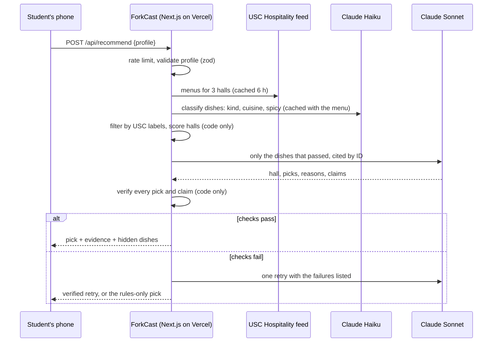

# How ForkCast works

One rule shapes the whole design: **allergens are decided by code from USC's labels, never by the model.** The AI is used where it is good (understanding what a dish is, choosing a plate, writing a reason) and boxed in everywhere a mistake could hurt someone.

## Request flow

## The five steps

| Step | Who | File | What it does |
| --- | --- | --- | --- |
| 1. Sort | AI (Haiku) | [`lib/enrich.ts`](../lib/enrich.ts) | Tags each dish name as main, side, dessert, drink, condiment or notice, plus cuisine, protein and spicy. Output is validated with zod. Any dish the model misses gets a keyword heuristic instead. It is never asked about allergens. |
| 2. Filter | Code | [`lib/filter.ts`](../lib/filter.ts), [`lib/exclude.ts`](../lib/exclude.ts) | Removes dishes carrying an allergen the student avoids, dishes missing a required diet label, and dishes USC marks "not analyzed for allergens" for anyone avoiding an allergen. Each hidden dish keeps the label that hid it. |
| 3. Score | Code | [`lib/score.ts`](../lib/score.ts), [`lib/closing.ts`](../lib/closing.ts) | Ranks halls by eligible mains and sides, taste matches, walking time and whether the hall closes before the student could get there. This renders first, before any AI call returns. |
| 4. Pick | AI (Sonnet) | [`lib/recommend.ts`](../lib/recommend.ts) | Sees only eligible dishes. Must name a hall, cite dishes by ID, and list its claims as codes (`no:sesame`, `halal-ingredients`). |
| 5. Verify | Code | [`lib/verify.ts`](../lib/verify.ts), [`lib/lang.ts`](../lib/lang.ts) | Rejects the answer if any dish is not on today's menu at that hall and meal, conflicts with the profile, was thumbed down, makes a claim USC's labels do not support, states a walking time not in the map data, states a calorie or gram number, or uses wording like "safe". |

If verification fails twice, or the AI is slow, down or out of credits, the student gets the rules-only pick from step 3. It passes the same checks.

## Data

- **Menus:** `GET hospitality.usc.edu/wp-json/hsp-api/v1/get-res-dining-menus/{hall}?y=&m=&d=` for EVK, Parkside and USC Village, normalized in [`lib/usc.ts`](../lib/usc.ts). Dish IDs are hashes of hall, meal, station and name, so they are stable through the day.
- **Labels:** 10 allergen labels and 3 diet labels, exactly as USC publishes them ([`lib/types.ts`](../lib/types.ts)).
- **Hours:** scraped from USC Hospitality with a saved copy as fallback ([`lib/hours-server.ts`](../lib/hours-server.ts)).
- **Walking:** minutes from 22 residences to each hall, precomputed from OpenStreetMap foot routes by [`scripts/walking.mjs`](../scripts/walking.mjs) into [`data/walking.json`](../data/walking.json). No map API is called at request time.
- **Snapshots:** saved menus for Nov 14–16 in [`data/snapshots`](../data/snapshots), used by the tests and by demo mode.

## State and privacy

- There are no accounts. A profile lives in the student's browser and moves between devices in a `#p=` link or QR code ([`lib/share.ts`](../lib/share.ts)). The part after `#` is never sent to a server.
- Upstash Redis stores three things: opt-in daily email subscriptions (double opt-in, @usc.edu only, 7-day expiry until confirmed), anonymous dish ratings keyed by a random browser ID, and rate-limit counters.

## Speed and cost

- The tagged menu for a day is cached for 6 hours in Next's data cache, so dish classification runs about once per day, not per student.
- A pick is cached for 3 hours per profile, date, meal, ratings and closing state. Only verified AI answers are cached, so a fallback gets a fresh AI attempt next time ([`lib/cached-recommend.ts`](../lib/cached-recommend.ts)).
- A daily cron calls `/api/warm` to tag today's and tomorrow's menus and precompute the sample students' picks.
- The hall comparison is computed by code and shown before the AI answer arrives.

## Staying up during a demo

Three switches in Vercel's Global Config take effect in about 15 seconds with no redeploy ([`lib/switches.ts`](../lib/switches.ts)):

| Switch | Effect |
| --- | --- |
| `useSavedMenus` | Read the saved snapshots instead of USC's live site |
| `rulesOnly` | Skip the AI and use code-only picks |
| `banner` | Show a one-line notice at the top of the app |

If the store is missing or unreadable, every switch is off.

## API

| Route | Method | Purpose | Guard |
| --- | --- | --- | --- |
| `/api/menu` | GET | Tagged menu for a date | Date must be within yesterday to +7 days |
| `/api/recommend` | POST | Hall, plate, evidence for a profile | 30/min per IP, profile validated |
| `/api/week` | POST | Best hall per meal for 7 days (code only) | 20/min per IP |
| `/api/parse-profile` | POST | One sentence → profile chips | 10/min per IP, 2,000 character cap |
| `/api/ratings`, `/api/ratings/lookup` | POST | Save or read 1–10 dish ratings | 300/hour per IP on writes, input validated |
| `/api/email/send` | POST | Email today's picks | 5/min per IP, one email per address per 10 min, @usc.edu only |
| `/api/email/confirm`, `/unsubscribe` | GET | Double opt-in and one-click removal | Random 36-character token |
| `/api/email/daily` | GET | Cron: send the daily email | Bearer `CRON_SECRET` |
| `/api/warm` | GET | Cron: warm the caches | Results are cached, so repeat calls do no new work |
| `/api/hours`, `/api/switches`, `/api/email/status` | GET | Hours, banner, feature flags | Read-only |

## Tests

206 tests in 16 files sit next to the code they cover and run on the saved menus with no network or API key. The largest group ([`lib/recommend.test.ts`](../lib/recommend.test.ts)) runs each of the eight sample students against saved meals and asserts that no pick, and no dish counted as eligible at any hall, carries an avoided allergen. It also asserts that the verifier rejects planted bad answers: an invented dish, a dish with a flagged allergen, a dish from another hall, a false label claim, an unknown hall, the same dish twice, a made-up walking time, and the word "safe". Other files cover the filter, closing-time logic, ratings math, rate limits, the emergency switches, colour contrast, and that all six translations have every string.

Results of the last full run, including the end-to-end check against the live site, are in [VERIFICATION.md](VERIFICATION.md).
